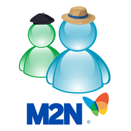
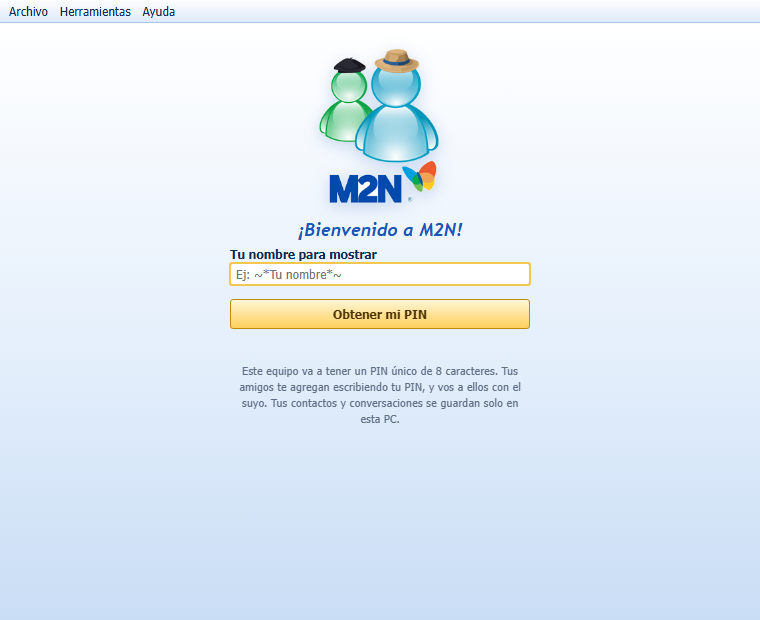
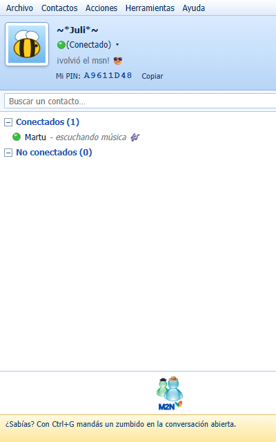
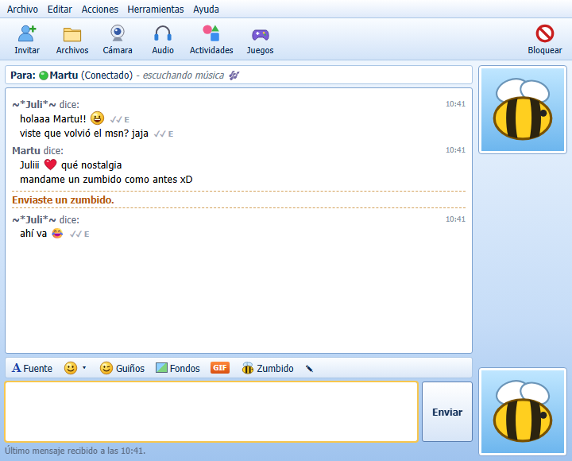
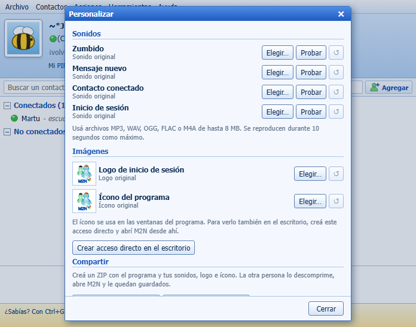
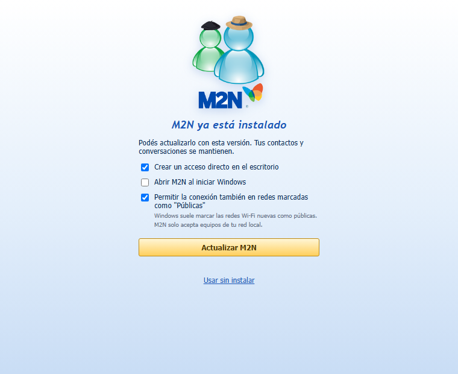
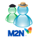

# M2N
<div align="center">



# M2N

**Un mensajero retro para tu red local. Sin servidores, sin cuentas, sin vueltas.**

Zumbidos, guiños, estados y mensajes personales, como en los viejos tiempos.<br>
Cada PC se conecta directo con la de sus contactos, con conexión cifrada.

[](../../releases/latest)
[](../../releases/latest)
[](https://go.dev)
[](#-cómo-funciona)

### [⬇️ Descargar M2N-Instalador.exe](../../releases/latest/download/M2N-Instalador.exe)

</div>

---

## 📸 Capturas

<div align="center">

| Inicio de sesión | Lista de contactos |
|:---:|:---:|
|  |  |
| **Conversación** | **Personalizar** |
|  |  |



<sub>El asistente de instalación</sub>

</div>

---

## ✨ Qué tiene

- 🔑 **Tu propio PIN.** Cada equipo recibe un PIN único de 8 caracteres. Tus amigos te agregan con tu PIN y vos a ellos con el suyo.
- 📡 **Encuentra gente en tu red.** M2N muestra quién más lo tiene abierto en la misma Wi-Fi o red cableada.
- 💬 **Mensajes, zumbidos y guiños**, como en el mensajero de siempre.
- 🟢 **Estados y mensaje personal**: Disponible, Ocupado, Ausente… y una frase debajo de tu nombre.
- 🖼️ **Avatares**: elegí uno de los incluidos o usá una imagen tuya (también GIF).
- 📁 **Envío de archivos** entre contactos.
- 📬 **Mensajes pendientes**: si tu contacto no está conectado, el mensaje queda guardado y se entrega cuando vuelve.
- 🔔 **Notificaciones** de Windows para mensajes y solicitudes nuevas.
- 🎨 **Personalizable**: cambiá los sonidos (MP3, WAV, OGG, FLAC o M4A), el logo de inicio de sesión y el ícono del programa.
- 📦 **Compartí tu M2N personalizado**: generá un ZIP con el programa y tus sonidos, logo e ícono. La otra persona lo descomprime y ya le queda igual.
- 🔒 **Conexión cifrada** y **sin servidores**: nadie más ve tus conversaciones.

---

## 🚀 Instalación

1. Descargá **[M2N-Instalador.exe](../../releases/latest/download/M2N-Instalador.exe)** desde la sección *Releases*.
2. Abrilo. Se abre el asistente de instalación, donde podés elegir:
   - ☑️ Crear un acceso directo en el escritorio
   - ☐ Abrir M2N al iniciar Windows
   - ☑️ Permitir la conexión también en redes marcadas como "Públicas"
3. Hacé clic en **Instalar M2N**. Al terminar, lo encontrás en el menú Inicio (y en el escritorio, si lo marcaste).

> 💡 **¿No querés instalarlo?** En el asistente elegí **Usar sin instalar** y M2N funciona en modo portable.

> ⚠️ **Aviso de Windows SmartScreen:** como el instalador no está firmado digitalmente, Windows puede mostrar "Windows protegió su PC". Hacé clic en **Más información → Ejecutar de todas formas**.

> 🌐 Windows suele marcar las redes Wi-Fi nuevas como *públicas*. Si tus contactos no aparecen, dejá activada la opción de redes públicas al instalar. M2N solo acepta equipos de tu red local.

---

## 👋 Primeros pasos

1. Abrí M2N y escribí **tu nombre para mostrar**.
2. Hacé clic en **Obtener mi PIN**. Ese es tu identificador; compartilo con tus amigos (**Copiar mi PIN**).
3. Para agregar a alguien: menú → **Agregar un contacto por PIN…**, escribí su PIN o elegilo de **Personas con M2N en tu red**.
4. Tu amigo recibe la solicitud y la acepta. ¡Listo, ya pueden chatear!

---

## 🔧 Cómo funciona

```
   PC de Ana  ◄──────── conexión directa y cifrada ────────►  PC de Beto
  (PIN A1B2C3D4)            misma red local                 (PIN E5F6G7H8)
        │                  (Wi-Fi o cable)                         │
        ▼                                                          ▼
  %APPDATA%\M2N                                              %APPDATA%\M2N
```

- **No hay servidor central.** Cada PC habla directamente con la de cada contacto.
- **Los dos tienen que estar en la misma red** (por ejemplo, la misma casa, oficina o escuela).
- **Tus datos se quedan en tu PC**: contactos, solicitudes, historial y mensajes pendientes se guardan en `%APPDATA%\M2N`.

---

## 🗑️ Desinstalar

Desde **Configuración → Aplicaciones** de Windows. Tus contactos, tu PIN y tus conversaciones quedan guardados en `%APPDATA%\M2N` por si lo volvés a instalar. Si querés borrar todo, eliminá también esa carpeta.

---

## ❓ Preguntas frecuentes

<details>
<summary><b>¿Funciona por internet, con amigos que están en otra casa?</b></summary>

No. M2N está pensado para la red local: los dos equipos tienen que estar conectados a la misma red.
</details>

<details>
<summary><b>No veo a mi contacto en la lista de "Personas con M2N en tu red"</b></summary>

Revisá que los dos estén en la misma red, que M2N esté abierto en ambas PCs y que el firewall de Windows lo permita (sobre todo si la red figura como "Pública").
</details>

<details>
<summary><b>¿Dónde están mis archivos recibidos?</b></summary>

En el menú, elegí <b>Ver archivos recibidos</b>.
</details>

<details>
<summary><b>¿Pierdo mi PIN si reinstalo?</b></summary>

No, mientras no borres la carpeta <code>%APPDATA%\M2N</code>.
</details>

---

## 📋 Requisitos

- Windows 10 u 11 (64 bits)
- Conexión a una red local (Wi-Fi o cable)

---

<div align="center">
<br>
<sub>M2N 2.0 · Hecho con 💙 para chatear como antes</sub>
</div>